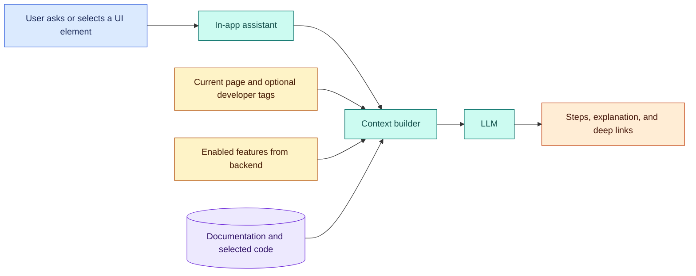

# An in\-app AI assistant that knows what each user can see

**Public case study. Implementation source is private.**

A prototype assistant built into an enterprise application\. It guides business users through tasks and answers questions using the current screen, the features they can access, and documentation written by the teams that own each part of the UI\.

**Role:** Sole builder  
**Status:** Prototype, demonstrated to stakeholders  
**Context:** 2026

**Technologies:** Python · Pydantic · React
**Technical topics:** LLM applications · Retrieval\-augmented generation · Context engineering · Micro\-frontends

## Highlights
- Answers are scoped to the features each user's license and feature flags enable
- Context\-aware help: step\-by\-step guidance, deep links, and explanations of any UI element the user selects
- Optional developer\-authored tags let each micro\-frontend team document its own UI

## Problem

Business users of a large enterprise application struggled to find features, complete multi\-step tasks, and get useful answers from documentation that was hard to navigate\.

They relied on reading docs, asking colleagues or support, and trial and error\. Repeated questions added to the support load\.

## Constraints

Users see different features depending on their license and feature\-flag setup, so a generic answer could describe something a user cannot access\.

The application is built from micro\-frontends hosted by multiple teams, so knowledge about the UI is spread across and owned by those teams\.

## Individual contribution

I designed and built the prototype on my own\.

The assistant answers questions, gives step\-by\-step instructions, provides deep links to the right place in the app, and explains a UI element when the user selects it\.

It builds its context from several sources: static documentation, the content of the user's current page, backend endpoints that report the user's enabled features, selected application code, and optional custom HTML tags in which developers describe their UI elements\.

## Architecture

### How the assistant builds an answer

A user asks a question or selects a UI element in the in\-app assistant\. A context builder combines the current page and optional developer tags, the user's enabled features from the backend, and documentation and selected code\. An LLM uses that context to produce steps, an explanation, and deep links\.

- Blue: user input
- Teal: assistant processing
- Purple cylinder: stored knowledge
- Amber: live context
- Orange: answer

## Engineering decisions

Scope answers to what each user can access

**Choice:** Fetch the user's enabled features from backend endpoints and combine them with the content of the page the user is on, which is already filtered for that user\.

**Alternative:** Answer from the full documentation set for every user\.

**Tradeoff:** Each answer depends on live context gathered at question time instead of a single static index\. In exchange, the assistant avoids describing features the user's license or flags do not include\.

Let the teams that own the UI explain it

**Choice:** Support optional custom HTML tags so each micro\-frontend team can describe its own UI elements with better context\.

**Alternative:** Rely only on a central documentation source maintained separately from the teams' code\.

**Tradeoff:** Tag coverage depends on which teams add them\. Because the tags are optional, the assistant still works from documentation, page content, and backend data where none exist\.

## Results and evidence

- **A working prototype was demonstrated to stakeholders, and product managers are now considering it for roadmap and funding\.**
  - Basis: Qualitative stakeholder feedback from demos\. No usage, accuracy, or support\-load impact has been measured\.

- **Answers are grounded in retrieved sources and limited to the features visible to the current user\.**
  - Basis: A property of the prototype's design: context is filtered by license and feature flags and by the user's current page\. Not yet tested systematically\.

## Limitations

No real measurement yet\. Answer accuracy has not been formally tested\.

User adoption has not been tested\.

Developer\-authored context depends on teams choosing to add tags\.

## Lessons

Giving the model the right, filtered context mattered more than the choice of model\.

In a distributed frontend, letting each team own the explanation of its UI fits better than a central knowledge base alone\.

## Next steps

Test answer accuracy systematically\.

Test adoption with real users\.
