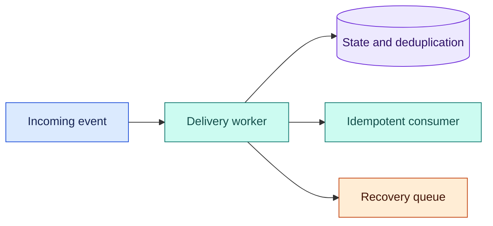

# Making event delivery predictable

**Synthetic example, not a real project or personal achievement.**

A synthetic backend case study about retrying safely, handling duplicates, and making failure visible\.

**Role:** Example backend engineer  
**Status:** Synthetic design example  
**Context:** Illustrative, not a real engagement

**Technologies:** TypeScript · PostgreSQL
**Technical topics:** Reliability · Event\-driven systems · Observability

## Highlights
- Explicit retry and failure states
- Idempotency at the consumer boundary
- A recovery path operators can inspect

## Problem

In this fictional scenario, an integration sends the same event more than once and downstream services occasionally time out\. A successful retry must not repeat the business action\.

The example explores a small, understandable design rather than an exactly\-once guarantee\.

## Constraints

Assume at\-least\-once delivery and temporary downstream failures\.

Keep the operational state visible without exposing customer payloads\.

## Individual contribution

This is a synthetic example, not a claim of personal work\. An engineer in this scenario would define delivery states, a deduplication boundary, and a recovery workflow\.

Team\-level deployment, security review, and production operation are not claimed\.

## Architecture

### A public\-safe delivery model

An incoming event reaches a worker\. The worker records delivery state and deduplication data, calls an idempotent consumer, and sends unresolved failures to a recovery queue\.

- Blue: input
- Teal: processing
- Purple cylinder: stored state
- Orange: recovery

## Engineering decisions

Make retries safe before making them automatic

**Choice:** Record a stable event key and the resulting state in the same transaction as the local business change\.

**Alternative:** Retry every timeout and assume the first attempt failed\.

**Tradeoff:** The transaction adds storage and cleanup work, but avoids treating an ambiguous network response as proof that nothing happened\.

Stop retrying when a person needs to decide

**Choice:** Use bounded backoff and a failed\-delivery queue with an explicit replay action\.

**Alternative:** Retry indefinitely without exposing an operator workflow\.

**Tradeoff:** A recovery queue needs ownership and clear diagnostics\. It makes unresolved failures visible instead of hiding them in an endless loop\.

## Results and evidence

- **The design illustrates how one event can be retried without repeating a local side effect\.**
  - Basis: Synthetic reasoning only\. No production system, benchmark, or measured improvement is represented\.

## Limitations

Cross\-service atomicity is not guaranteed\. A downstream system still needs an explicit idempotency contract\.

## Lessons

Name ambiguous states instead of pretending every request is a clear success or failure\.

## Next steps

For a real project, verify the failure model with duplicate, timeout, replay, and partial\-completion tests\.
